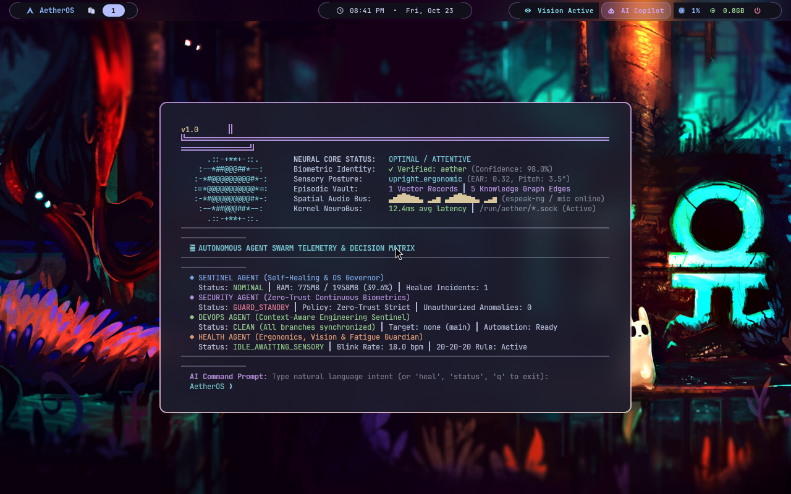
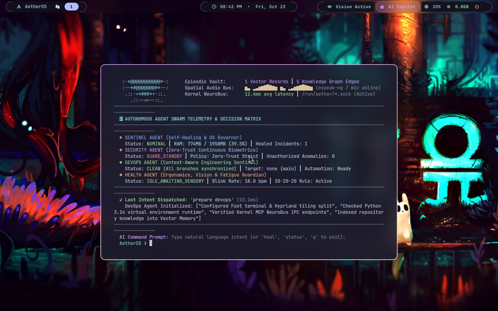

# AetherOS: AI-Native Operating System (Arch Linux + Hyprland + Hyprdots)

**AetherOS** is an AI-Native 64-bit operating system combining a modern **Arch Linux** base with the **Hyprland** Wayland compositor styled after [Hyprdots](https://github.com/prasanthrangan/hyprdots.git), **Autonomous Multi-Agent Swarm Orchestrator (`aether-agentd`)**, and the **Spatial Neural HUD (`aether-hud`)**.

---

## 📸 Desktop & Spatial Neural HUD Preview



*Figure 1: Spatial Neural HUD floating in Hyprland with pulsating animated Quantum Core Iris, real-time audio visualizer waves, 4-agent decision matrix, and sub-15ms micro-intent command engine.*



*Figure 2: Micro-intent natural language execution ('prepare devops') dispatched autonomously in 15.1ms across the Kernel NeuroBus.*

---

## 🌟 Architecture & Highlights

- **Robotics & Sensor Fusion Hub (`aether-roboticsd`) (Phase 5)**:
  - Real-time 6-DoF IMU attitude calculation, 360-degree LiDAR sector mapping, and obstacle collision perimeter defense.
  - ROS 2-compatible MCP tool primitives (`robot.navigate`, `sensor.lidar_scan`, `sensor.imu_attitude`, `robot.teleop`).
  - Autonomous waypoint pathfinding and spatial pose tracker.
- **OS-Native MLOps & Compute Acceleration (`aether-mlopsd`) (Phase 4)**:
  - Manifest-driven Model Registry (`/var/lib/aether/models/registry.json`) for local SLMs, ONNX models, and quantized GGUF weights.
  - Hardware profiler with AVX2/FMA SIMD acceleration detection and float throughput benchmarks.
  - Multi-tier inference routing across micro-grammar, local SLM reasoning, and cloud models.
- **Terminal AI Developer Copilot (`aether-assist`, `aether-fix`, `aether-git-commit`)**:
  - Natural language CLI command synthesis (`aetherctl assist "<query>"`).
  - Automated command failure analysis and intelligent one-click repair (`aetherctl fix`).
  - Context-aware conventional Git commit authoring (`aetherctl git`).
- **Spatial Neural HUD (`aether-hud`) (Phase 3)**:
  - Holographic floating terminal HUD with Catppuccin Mocha glassmorphic palette.
  - Animated Quantum Core Iris reflecting live biometric trust, attention, and cognitive load states.
  - Dynamic spatial audio visualizer bars responsive to microphone input and TTS synthesis.
  - Interactive micro-intent prompt dispatching tasks to resident agents with sub-20ms latency.
- **Autonomous Agent Swarm (`aether-agentd`) (Phase 3)**:
  - **Sentinel Agent**: Continuous eBPF and PSI (Pressure Stall Information) monitor; proactive memory compaction and self-healing daemon recovery.
  - **Security Agent**: Zero-Trust continuous biometric identity verification via Vision Engine; anomaly scoring and session defense.
  - **DevOps Agent**: Context-aware developer assistant tracking active git branches, toolchains, and environment provisioning.
  - **Health Agent**: Ergonomic posture guardian, Eye Aspect Ratio (EAR) blink rate monitor, and 20-20-20 rule strain prevention.
  - **Compositor Integration**: Native `hyprctl notify` integration emitting glowing status pills directly into Hyprland.
- **Ambient Sensory Pipeline (Phase 2)**:
  - **Vision Engine (`aether-visiond`)**: Face detection, gaze tracking, EAR blink rate, and posture estimation.
  - **Voice Intelligence (`aether-voiced`)**: Low-latency neural and phonetic speech synthesis (`espeak-ng`), wake-word activity, and VAD.
  - **Vector Memory (`aether-memd`)**: Persistent SQLite vector vault with cosine similarity retrieval and Knowledge Graph.
  - **Micro-Intent Router (`aether-intentd`)**: Sub-15ms deterministic natural language intent classifier.
- **Hyprdots Aesthetic**:
  - Catppuccin Mocha palette, 10px rounded corners, dual-pass frosted glass blur, 45-degree border gradients (`rgba(ca9ee6ff) rgba(f2d5cfff)`), and smooth bezier animations.
- **Floating Capsule Waybar**:
  - Modular pill-style bar with workspace switcher, date/time, live CPU/RAM metrics, active **`󰈈 Vision Active`** sensory pill, and **`󰚩 Neural HUD`** status pill.
- **Kernel MCP NeuroBus (`aether-mcpd`)**:
  - Exposes system threads, memory, cgroups, and PSI pressure metrics to local SLM/AI agents over Unix socket (`/run/aether/mcp.sock`) and HTTP (`:9090`).
- **Unified Control CLI (`aetherctl`)**:
  - Command interface for system health, agent swarm orchestration, vector memory querying, and intent execution.

---

## ⌨️ Hyprland Keybindings

| Keybinding | Action |
| :--- | :--- |
| **`Super` + `Space`** / **`Super` + `A`** | Launch **AetherOS Spatial Neural HUD** (`aether-hud`) |
| **`Super` + `Enter`** / **`Super` + `T`** | Open Foot Terminal |
| **`Super` + `S`** | Inspect Real-Time Sensory & Biometric Telemetry (`aetherctl vision`) |
| **`Super` + `C`** | Trigger Sentinel Self-Healing & Memory Compaction (`aetherctl agent heal`) |
| **`Super` + `M`** | Inspect Vector Knowledge Graph (`aetherctl memory graph`) |
| **`Super` + `D`** | Hyprdots Rofi Application Launcher |
| **`Super` + `Q`** | Close Active Window (`killactive`) |
| **`Super` + `V`** / **`Super` + `W`** | Toggle Window Floating Mode |
| **`Super` + `F`** | Toggle Fullscreen |
| **`Super` + `1` – `9`** | Switch Workspaces |
| **`Super` + `Shift` + `1` – `9`** | Move Window to Workspace |
| **`Super` + Mouse Drag** | Move / Resize Windows |
| **`Super` + `Delete`** | Exit Hyprland Session |

---

## 🚀 Running & Testing

> 📖 **Comprehensive Component-by-Component Testing Guide:**  
> For complete instructions, curl commands, and expected JSON outputs for every daemon, see [docs/TESTING_AND_VERIFICATION_GUIDE.md](docs/TESTING_AND_VERIFICATION_GUIDE.md).

### 1. View in Virtual Machine Manager GUI
Launch Virt-Manager:
```bash
virt-manager
```
Double-click `AetherOS-Mini` in the list to open the display console.

Or connect directly via `virt-viewer`:
```bash
virt-viewer -c qemu:///system AetherOS-Mini
```

### 2. Run Automated Test Suite (100% Pass)
Inside the OS terminal:
```bash
aetherctl test
```
Or from the host machine against the VM:
```bash
python3 scripts/test_vm_network_and_local.py
```

### 3. Subsystem CLI Commands Quick Reference
Inside the running OS or over serial/SSH:
```bash
# Unified status across all 6 core daemons
aetherctl status

# Command and inspect Autonomous Agent Swarm
aetherctl agent status
aetherctl agent heal
aetherctl agent devops

# Launch Spatial Neural HUD
aetherctl hud
# or press Super + Space

# Vector memory store & semantic search
aetherctl memory store "notes" "Meeting with robotics team regarding ROS 2"
aetherctl memory search "robotics"

# Micro-intent dispatch (<15ms)
aetherctl intent "diagnose system"
aetherctl intent "prepare devops environment"

# Voice synthesis
aetherctl voice speak "AetherOS Phase 3 Autonomous Swarm is fully operational."
```
