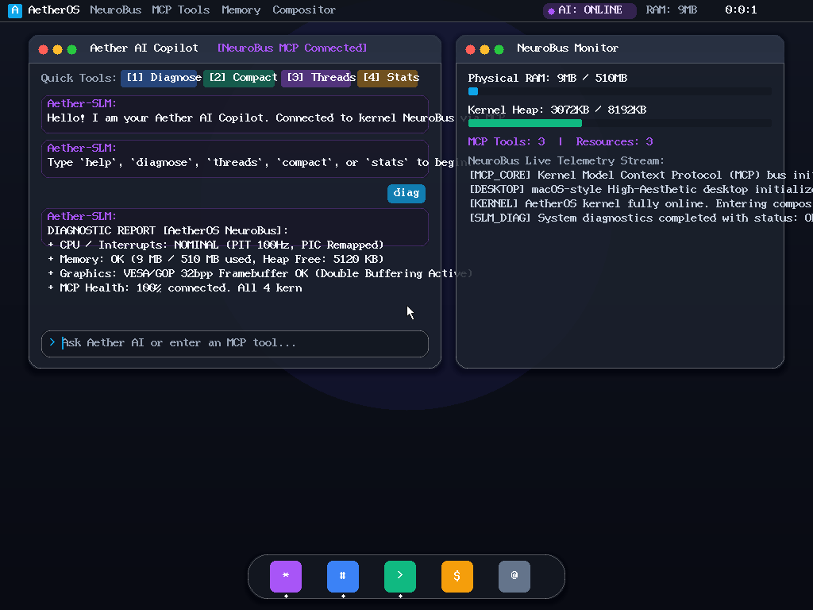

# AetherOS: AI-Native Bare-Metal Operating System

**AetherOS** is an AI-Native 64-bit (x86_64) bare-metal operating system built for PC hardware, merging low-level systems programming with modern AI/SLM integration and a clean macOS / iOS aesthetic.



---

## 🌟 Key Features

### 1. AI-Native Kernel & MCP Architecture (NeuroBus)
- **Model Context Protocol (MCP)**: Every kernel component, thread, memory pool, and device driver is instrumented with an MCP interface exposing **Tools**, **Resources**, and **Telemetry Events**.
- **Embedded SLM Copilot**: An onboard Small Language Model intelligence agent runs in the operating system loop. It parses user intent, executes diagnostics, defragments memory, and monitors system health in real-time.
- **Dynamic Optimization**: The SLM Copilot can invoke kernel tools like `ai.system_diagnose`, `kernel.mem_compact`, and `kernel.thread_tune` to autonomously maintain peak responsiveness.

### 2. High-Aesthetic GUI (macOS & iOS Inspired)
- **True-Color Linear Framebuffer (1024x768x32bpp ARGB)**: High-resolution graphics initialized directly via Limine bootloader (UEFI GOP & BIOS VBE).
- **Double-Buffered Compositor**: Zero-flicker 60fps rendering pipeline with hardware/software responsive mouse cursor.
- **macOS Top Menu Bar**: Frosted translucent bar featuring system menus, real-time clock, physical RAM meter, and a pulsing AI status indicator.
- **Floating Dock**: Bottom pill container with smooth rounded corners, drop shadows, and active running indicator dots.
- **Translucent Windows**: Frosted glass windows featuring macOS traffic-light controls (close, minimize, maximize), interactive chat bubbles, and real-time telemetry meters.

### 3. Bare-Metal Foundation
- **64-bit Long Mode**: Higher-half kernel linked at `0xffffffff80000000`.
- **Global Descriptor Table (GDT) & TSS**: 64-bit segment descriptors and task state segment.
- **Interrupt Descriptor Table (IDT)**: 256 interrupt gates handling CPU exceptions (0-31) and hardware IRQs (32-47).
- **8259 PIC & PIT Timer**: Remapped interrupt controllers and 100Hz Programmable Interval Timer.
- **Drivers**: Serial COM1 (UART 16550), PS/2 Keyboard with scancode-to-ASCII translation, and PS/2 Mouse with 3-byte packet decoding.
- **Physical Memory Manager (PMM)**: Bitmap page frame allocator managing 4KB pages from the bootloader memory map.
- **Kernel Heap Allocator**: 16-byte aligned dynamic memory allocator (`kmalloc`, `kfree`, `kcalloc`, `krealloc`) with block coalescing.

---

## 🚀 Building & Running

### Prerequisites
- `gcc` (with 64-bit support)
- `ld` (GNU linker)
- `make`
- `xorriso`
- `qemu-system-x86_64`

### Quick Start
```bash
# 1. Clone repository
git clone <repo-url>
cd AetherOs

# 2. Build kernel and bootable hybrid ISO
make

# 3. Launch in QEMU with graphical window and serial telemetry
make run

# Or launch headlessly for automated testing
make run-headless
```

---

## 💾 Booting on Real Physical PC Hardware

`aetheros.iso` is a hybrid ISO compatible with both modern **UEFI** and legacy **BIOS** hardware:

1. Identify your USB drive path (e.g. `/dev/sdb`):
   ```bash
   lsblk
   ```
2. Write the image directly to the USB drive:
   ```bash
   sudo dd if=aetheros.iso of=/dev/sdX bs=4M status=progress conv=fsync
   ```
3. Insert the USB drive into your PC, enter the BIOS/UEFI boot menu (F12, F11, or Del), select the USB drive, and boot into AetherOS!

---

## 🧠 Interacting with the AI Copilot

Once the desktop loads:
- **Click Quick Action Buttons**:
  - `[1] Diagnose`: Runs comprehensive kernel health checks.
  - `[2] Compact`: Reclaims and coalesces free heap fragments.
  - `[3] Threads`: Inspects thread scheduling on the NeuroBus.
  - `[4] Stats`: Queries live telemetry metrics.
- **Type in the Input Bar**:
  - Type `help` to list commands.
  - Type `diagnose system` to trigger an automated diagnosis.
  - Type `compact memory` to trigger memory compaction.
  - Type `threads` to inspect active kernel tasks.

---

## 📁 Project Structure

```
AetherOs/
├── Makefile                # Build system
├── limine.conf             # Bootloader configuration
├── linker.ld               # 64-bit higher-half linker script
├── screenshot.png          # System screenshot
├── include/                # Header files
│   ├── aether.h            # Main kernel definitions
│   ├── types.h             # Fixed-width types (u8, u16, u32, u64)
│   ├── io.h                # Port I/O instructions (inb, outb, cli, sti)
│   ├── string.h            # String utilities (memcpy, vsnprintf, strcmp)
│   ├── gdt.h               # GDT & TSS structures
│   ├── idt.h               # IDT & register structures
│   ├── pic.h               # 8259 PIC driver
│   ├── pmm.h               # Physical memory manager
│   ├── heap.h              # Dynamic kernel heap
│   ├── serial.h            # Serial UART COM1 driver
│   ├── timer.h             # PIT timer driver
│   ├── keyboard.h          # PS/2 keyboard driver
│   ├── mouse.h             # PS/2 mouse driver
│   ├── font.h              # 8x16 bitmap font
│   ├── gfx.h               # 32bpp ARGB graphics primitives
│   ├── compositor.h        # Double-buffer compositor & cursor
│   ├── desktop.h           # macOS/iOS desktop renderer
│   ├── mcp.h               # Kernel Model Context Protocol
│   └── slm.h               # Embedded SLM copilot
└── src/                    # Implementation files
    ├── main.c              # Kernel bootstrap & main event loop
    ├── arch/x86_64/        # GDT, IDT, PIC, and ISR assembly stubs
    ├── drivers/            # COM1, Timer, Keyboard, Mouse
    ├── mm/                 # PMM and Heap allocators
    ├── gfx/                # Font bitmaps and 32bpp software renderer
    ├── ui/                 # Compositor and macOS desktop
    ├── mcp/                # MCP tool/resource engine and SLM copilot
    └── lib/                # Freestanding C runtime library
```
