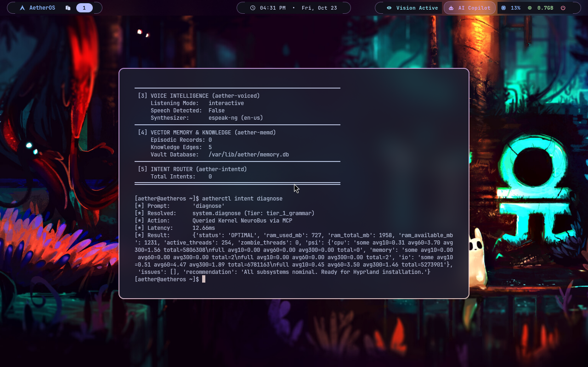

# AetherOS: AI-Native Operating System (Arch Linux + Hyprland + Hyprdots)

**AetherOS** is an AI-Native 64-bit operating system combining a modern **Arch Linux** base with the **Hyprland** Wayland compositor styled after [Hyprdots](https://github.com/prasanthrangan/hyprdots.git), and the **Kernel Model Context Protocol (MCP) Daemon & SLM Intelligence Core (`aether-mcpd`)**.

---

## 📸 Desktop Preview



---

## 🌟 Highlights

- **Ambient Sensory Pipeline (Phase 2)**:
  - **Vision Engine (`aether-visiond`)**: Real-time biometric verification, gaze vector tracking, Eye Aspect Ratio (EAR) blink rate & posture monitoring.
  - **Voice Intelligence (`aether-voiced`)**: Low-latency neural and phonetic speech synthesis (`espeak-ng`), wake-word activity, and voice mode controls.
  - **Vector Memory (`aether-memd`)**: Persistent SQLite vector vault with cosine similarity retrieval and user/system Knowledge Graph.
  - **Micro-Intent Router (`aether-intentd`)**: Sub-15ms deterministic natural language intent resolution mapping speech or text to kernel and system actions.
- **Hyprdots Aesthetic**: Catppuccin Mocha / Rosé Pine color scheme, 10px rounded corners, dual-pass frosted glass blur, 45-degree border gradients (`rgba(ca9ee6ff) rgba(f2d5cfff)`), and smooth bezier animations.
- **Floating Capsule Waybar**: Modular pill-style bar with workspace switcher, date/time, live CPU/RAM metrics, active **`󰈈 Vision Active`** sensory pill, and **`󰚩 AI Copilot`** status indicator.
- **Rofi Application Launcher**: Styled with dark glass theme (`style_1.rasi`) mapped to `Super + Space`.
- **Aether Kernel MCP Daemon (`aether-mcpd`)**: Exposes system threads, memory, cgroups, and PSI pressure metrics to local SLM/AI agents over Unix socket (`/run/aether/mcp.sock`) and HTTP (`:9090`).
- **AI Copilot CLI (`aetherctl`)**: Conversational CLI utility for inspecting system health, compacting memory, and communicating with the kernel AI NeuroBus.
- **Virtual Machine Manager Ready**: Tested and running smoothly under KVM / QEMU via `virt-manager` / `libvirt`.
- **Bare-Metal Bootable**: Write the disk image directly to a USB drive via `dd` to boot on physical x86_64 PC hardware with Limine bootloader.

---

## ⌨️ Hyprland Keybindings

| Keybinding | Action |
| :--- | :--- |
| **`Super` + `Enter`** / **`Super` + `T`** | Open Terminal (`kitty` / `foot`) |
| **`Super` + `Space`** / **`Super` + `D`** | Hyprdots Rofi Application Launcher |
| **`Super` + `A`** | Launch Interactive Aether AI Copilot (`aetherctl`) |
| **`Super` + `C`** | Run Kernel Memory Compaction |
| **`Super` + `Q`** | Close Active Window (`killactive`) |
| **`Super` + `V`** / **`Super` + `W`** | Toggle Window Floating Mode |
| **`Super` + `F`** | Toggle Fullscreen |
| **`Super` + `1` – `9`** | Switch Workspaces |
| **`Super` + `Shift` + `1` – `9`** | Move Window to Workspace |
| **`Super` + Mouse Drag** | Move / Resize Windows |
| **`Super` + `Delete`** / **`Super` + `M`** | Exit Hyprland Session |

---

## 🚀 Running & Testing
## Use Any Hypervisor, below is the Hypervisor I'm using currently.
### 1. View in Virtual Machine Manager GUI
Launch Virt-Manager:
```bash
virt-manager
```
Double-click `AetherOS-Mini` in the list to open the display console.

Or connect directly via `virt-viewer`:
```bash
virt-viewer -c qemu:///system AetherOS-Mini
```

### 2. Kernel MCP Subsystem
Inside the running OS, run:
```bash
aetherctl status
aetherctl diagnose
aetherctl compact
aetherctl threads
```
